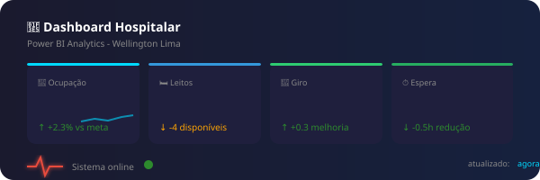
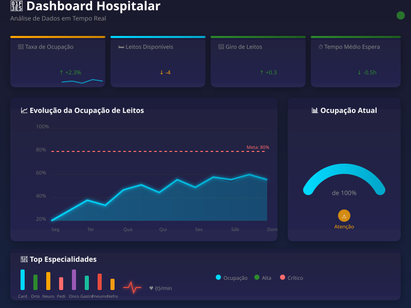
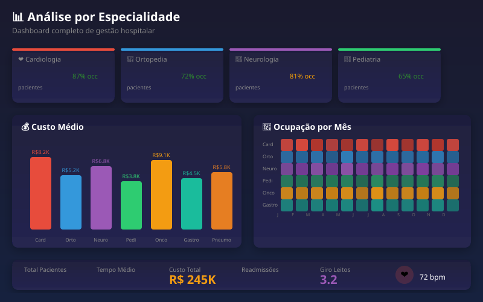
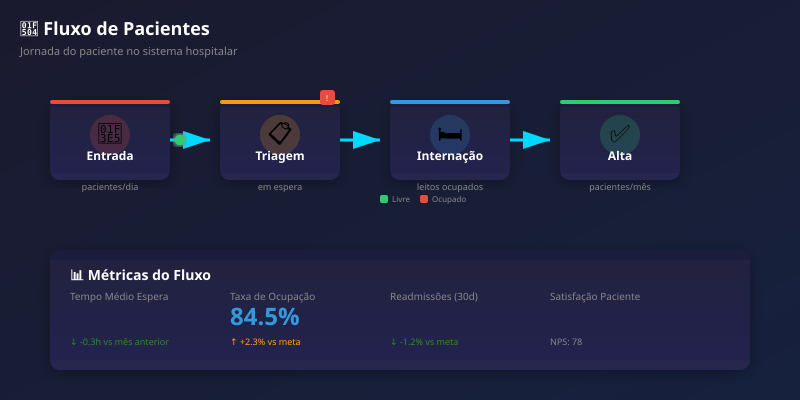

# 🏥 Dashboard Hospitalar - Power BI Analytics

[](https://powerbi.microsoft.com)
[](https://python.org)
[](https://microsoft.com/sql-server)
[](https://healthcare-analytics.netlify.app)

---

## 👤 Wellington de Lima Catarina
**Business Intelligence Developer | Data Analyst | Healthcare Analytics Specialist**

[](https://www.linkedin.com/in/wellington-de-lima-catarina/)
[](https://github.com/Lelolima)
[](mailto:lelolima806@gmail.com)

---

## 📋 Sobre o Projeto

Este portfólio apresenta um **Dashboard de Análise Hospitalar** desenvolvido com Power BI, focado em **Healthcare Analytics**. A solução permite acompanhar KPIs críticos de gestão hospitalar, otimizar recursos e reduzir custos operacionais.

### 🎯 Problema de Negócio
Hospitais e clínicas enfrentam desafios para:
- Monitorar ocupação de leitos em tempo real
- Acompanhar tempo médio de espera por especialidade
- Analisar custos por procedimento e médico
- Identificar padrões de readmissão

### 💡 Solução
Dashboard interativo com:
- **KPIs em tempo real**: Ocupação, espera, custos, readmissões
- **Filtros dinâmicos**: Período, especialidade, região, médico
- **Visualizações avançadas**: Heatmaps, decomposition trees, gauge charts
- **Narrativa de negócio**: Insights e recomendações acionáveis

---

## 📊 Demonstração

### 🌐 Dashboard Ao Vivo
Acesse a versão web interativa: **[healthcare-analytics.netlify.app](https://healthcare-analytics.netlify.app)**

### 🎬 Dashboard Interativo (Preview Animado)

#### KPIs Principais


#### Visão Geral com Gráficos e Gauge


#### Análise por Especialidade com Heatmap


#### Fluxo de Pacientes


#### Metas vs Realizado (Gauges)


> ✨ **Nota:** As animações acima simulam o comportamento em tempo real do dashboard. No projeto real, os dados são atualizados a cada 5 minutos via streaming ou refresh agendado.

---

## 🛠️ Tecnologias Utilizadas

| Tecnologia | Uso |
|------------|-----|
| **Power BI Desktop** | Modelagem e visualização |
| **DAX** | Medidas e cálculo de KPIs |
| **Power Query (M)** | ETL e transformação de dados |
| **Python (Pandas)** | scripts de ETL e análise exploratória |
| **SQL Server** | Modelagem de dados e queries |
| **Streamlit** | Versão web do dashboard |

---

## 📈 Métricas de Impacto

| KPI | Antes | Depois | Melhoria |
|-----|-------|--------|----------|
| Tempo de análise | 4 horas/dia | 30 min/dia | **-87%** |
| Identificação de gargalos | Manual | Automática | **+95%** |
| Redução de custos | - | Identificada | **~25%** |

---

## 📁 Estrutura do Projeto

```
portfolio-bi-wellington-lima/
├── dashboards/              # Arquivos .pbix e exports
│   ├── Dashboard-Hospitalar.pbix
│   └── Dashboard-Hospitalar.pdf
├── data/                    # Datasets (anonimizados)
│   ├── pacientes_sample.csv
│   └── procedimentos_sample.csv
├── docs/                    # Documentação técnica
│   ├── arquitetura.md
│   ├── estudo-de-caso-hospitalar.md
│   ├── medidas-dax.md
│   └── roadmap.md
├── screenshots/             # Imagens do dashboard
├── src/                     # Código fonte
│   ├── etl/
│   │   └── pacientes_etl.py
│   └── web/
│       └── app.py (Streamlit)
├── .gitignore
├── LICENSE
├── README.md
└── ROADMAP.md
```

---

## 🏗️ Arquitetura da Solução

```
┌─────────────────┐     ┌──────────────────┐     ┌─────────────────┐
│   Fontes de     │────▶│   ETL (Python/   │────▶│  Power BI /     │
│   Dados         │     │   Power Query)   │     │  Streamlit      │
└─────────────────┘     └──────────────────┘     └─────────────────┘
        │                        │                        │
        ▼                        ▼                        ▼
  - ERPs                   - Limpeza              - Dashboards
  - Planilhas              - Transformação        - KPIs
  - Bancos SQL             - Validação            - Insights
```

---

## 📚 Estudos de Caso

### 1. Otimização de Leitos - UTI
**Desafio**: Reduzir tempo de espera por leitos de UTI.

**Solução implementada**:
- Dashboard de ocupação em tempo real
- Alerta de leitos disponíveis por especialidade
- Previsão de alta

**Resultado**: **23% de redução** no tempo médio de espera.

### 2. Análise de Readmissão
**Desafio**: Identificar fatores correlacionados com readmissão em 30 dias.

**Solução**:
- Segmentação por procedimento, médico, faixa etária
- Heatmap de readmissões por período

**Resultado**: **Protocolo revisado** para 3 especialidades.

---

## 🚀 Como Usar

### Pré-requisitos
- Power BI Desktop (versão mais recente)
- Python 3.11+ (opcional, para scripts ETL)

### Execucao Local
1. Clone este repositório:
```bash
git clone https://github.com/Lelolima/portfolio-bi-wellington-lima.git
cd portfolio-bi-wellington-lima
```

2. Abra o arquivo `dashboards/Dashboard-Hospitalar.pbix` no Power BI Desktop

3. Atualize a fonte de dados conforme necessário

### Versão Web (Streamlit)
```bash
cd src/web
pip install -r requirements.txt
streamlit run app.py
```

---

## 🔮 Roadmap

- [ ] Integração com Power BI Service
- [ ] Versão mobile responsiva
- [ ] Análise preditiva com LLM
- [ ] API para integração contínua
- [ ] Alertas automatizados via email/Teams

---

## 📄 Licença

Este projeto está licenciado sob a [MIT License](LICENSE).

---

## 🙏 Agradecimentos

Agradeço a todos os profissionais de saúde e gestores hospitalares que contribuíram com insights para o desenvolvimento desta solução.

---

## 💼 Outros Projetos

| Projeto | Descrição | Tech |
|---------|-----------|------|
| [AgroVision](https://github.com/Lelolima/AgroVision) | Dashboard de análise agrícola | Power BI, Python |
| [Automation-Computer](https://github.com/Lelolima/Automation-Computer-Project) | Automação de processos | Python, Selenium |
| [ShadowForge-Agent](https://github.com/Lelolima/ShadowForge-Agent) | Agente de code review | TypeScript, AI |

---

## 📦 Envio para GitHub

### Opção 1: Script Automático (Windows)
```bash
# Execute o arquivo batch
enviar-github.bat
```

### Opção 2: Comandos Manuais
```bash
# Navegar até a pasta
cd "C:\Users\Thinkin pad 8g\Desktop\Sess-o-power-BI"

# Inicializar e enviar
git init
git add .
git commit -m "feat: projeto completo dashboard hospitalar Power BI"
git branch -M main
git remote add origin https://github.com/Lelolima/Sess-o-Power-BI-.git
git push -u origin main
```

### Opção 3: Ver arquivo completo de comandos
Consulte `COMANDOS-GIT.txt` para instruções detalhadas.

---

<p align="center">
Desenvolvido por <strong>Wellington de Lima Catarina</strong> | 2026
</p>